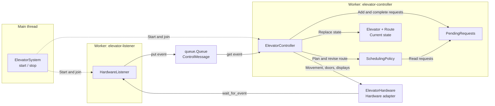
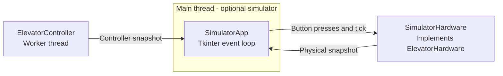

# Elevator Controller

מימוש של בקר המעלית עם מדיניות תזמון, אירועי חומרה ושני חוטי עבודה.
החיבור לחומרה מוגדר כממשק; ההדגמה והבדיקות משתמשות בחומרה מדומה
שמקבלת אירועים ידניים. אין חיבור למנוע או למעלית פיזית.

להרחבה התאורטית הנדרשת בתרגיל, ראה [ארכיטקטורה לשתי מעליות](TWO_ELEVATORS.md).
המסמך מתאר את חלוקת האחריות, החוטים וכללי שיוך הקריאות; ההרחבה אינה ממומשת בקוד.

להשוואה מול מדיניות של עדיפות פנימית מחמירה, ראה [כלי ההשוואה והגרפים](comparison/README.md).
`BaselinePolicy` נמצאת לצד המדיניות הקיימת; כלי הניסוי והפלטים נמצאים בתיקייה נפרדת.

## הרצה

נדרשת Python 3.10 ומעלה. הקוד משתמש בספרייה הסטנדרטית בלבד.

```powershell
py -m unittest discover -s tests -v
py -m elevator_controller
```

הפקודה השנייה מפעילה שני חוטי עבודה ומדגימה התחייבות לאיסוף בקומה 8,
עצירת ביניים בקומה 7 ובקשה חדשה לרדת לקומה 1. התוכנית הראשית מדמה
דיווחי הגעה ופתיחת/סגירת דלתות; החומרה המדומה אינה יוצרת חוט נוסף.
התוצאה: שירות בקומות 7, 8 ואז 1, חזרה למצב פנוי וכיבוי שני החוטים.

להדגמת האלגוריתם בלבד, ללא חוטים:

```powershell
py -m elevator_controller --policy-only
```

## מבנה

| קובץ | אחריות |
| --- | --- |
| `elevator_controller/models.py` | בקשות, מצבי מעלית, עצירה ומסלול |
| `elevator_controller/requests.py` | איחוד בקשות כפולות והשלמת שירות |
| `elevator_controller/scheduler.py` | בחירת מסלול והצעת עצירות ביניים |
| `elevator_controller/events.py` | הודעות לחיצות, חיישנים, סיום פעולות ותקלות |
| `elevator_controller/hardware.py` | הצהרת ממשק החומרה וחוזה הפעולות |
| `elevator_controller/listener.py` | קליטת אירועים והעברתם לתור |
| `elevator_controller/controller.py` | טיפול באירועים, בקשות, מסלול ודלתות |
| `elevator_controller/runtime.py` | הפעלה וכיבוי של שני חוטי העבודה |
| `elevator_controller/fake_hardware.py` | חומרה מדומה ותיעוד פקודות לצורך בדיקה |
| `tests/test_scheduler.py` | בדיקות התנהגות וגבולות |
| `tests/test_controller.py` | בדיקות הבקר עם זמן ידני ואירועי חומרה |
| `tests/test_runtime.py` | בדיקות שילוב עם שני חוטים אמיתיים |

`HallRequest` ו-`CabinRequest` הן מחלקות נתונים. `Elevator` הוא צילום מצב
בלתי ניתן לשינוי; הבקר מחליף אותו בעקבות אירועי חומרה. `Route` גם
הוא בלתי ניתן לשינוי, כך שהצעה לשינוי מסלול לא משנה את המסלול הפעיל.

## מדיניות התזמון

1. מתכננים מסלול חדש רק כשאין מסלול פעיל או התחייבות שירות אחרת,
   המעלית עומדת, הדלתות סגורות ואין תקלה.
2. קריאה חיצונית שעברה את סף ההמתנה מקבלת עדיפות; מבין כאלה נבחרת הוותיקה.
3. אחרת, ממשיכים את כיוון השירות הנוכחי כל עוד יש יעדים בהמשך הכיוון.
   בקשות פנימיות שנמצאות מאחור נשמרות לסבב החזרה. בקשה פנימית בקומה
   הנוכחית יכולה לקבל שירות בלי להתחיל נסיעה נוספת.
4. כשאין סבב להמשיך, בקשה פנימית קרובה קובעת את הכיוון; בשוויון מרחק
   מעדיפים את הכיוון הקודם, אם יש כזה, ואז את הקומה הנמוכה. בהיעדר בקשות
   פנימיות נבחרת הקריאה החיצונית הוותיקה ביותר כיעד איסוף.
5. סבב שירות יכול להתארך ליעדים חדשים בהמשך אותו כיוון. נוסעים עד הקומה
   הרחוקה ביותר שיש בה בקשה רלוונטית, ולא אוטומטית עד קצה הבניין.
   בדרך אוספים קריאות חיצוניות שמתאימות לכיוון. קריאה בכיוון ההפוך יכולה
   לקבוע את נקודת ההיפוך: למשל עלייה ל-8 כדי להתחיל שם שירות בירידה.
   אם נקודת ההיפוך מתרחקת לפני שהשירות בה התחיל, הקריאה ההפוכה הישנה
   נשארת ממתינה לחזרה; יעד פנימי באותה קומה עדיין מקבל עצירה בדרך.
6. נסיעה ייעודית לאיסוף נוסע שרוצה לנסוע בכיוון ההפוך אינה סבב שירות
   בכיוון ההגעה. בדרך לאיסוף הראשון יש חריג: אם אין בקשות פנימיות וכיוון הנסיעה הפוך
   לכיוון המבוקש בקריאת האיסוף, אפשר להרחיב את הנסיעה לקריאה רחוקה יותר
   בהמשך הדרך שמבקשת את אותו כיוון שירות. בוחרים את הרחוקה ביותר מבין
   הקריאות המתאימות. האיסוף המקורי נשאר ממתין לנסיעה חזרה עם זמן הקבלה
   המקורי שלו; עצירות ביניים אחרות שכבר הובטחו נשמרות.
7. הרחבת נסיעת האיסוף שבסעיף 6 מותרת רק לפני השירות הראשון ובדלתות
   סגורות, ובקשה פנימית חוסמת אותה. בכל סוג מסלול, קריאה חיצונית שכבר
   הגיעה לסף ההמתנה חוסמת הרחבה נוספת. משלימים את המסלול שכבר התקבל,
   ובתכנון הבא מעניקים קדימות לקריאה הוותיקה. אין הופכים כיוון באמצע נסיעה.
8. הגעה או אישור פקודה אינם השלמת בקשה. מסירים בקשות רק אחרי פתיחת
   דלתות, ובקריאות חיצוניות מסירים רק את כיוון השירות.

עדיפות לפקודות פנימיות משמשת בבחירת סבב חדש, אך אינה מחייבת לבטל סבב
שירות פעיל בגלל יעד פנימי שנמצא בכיוון ההפוך. עצירות בכיוון הסבב נשמרות.
קריאה שמיועדת לאיסוף בנקודת ההיפוך יכולה להידחות כשנקודת ההיפוך מתרחקת;
לא מוחקים אותה ולא מאפסים את זמן ההמתנה. התחייבות לנסיעת איסוף ייעודית
נשמרת, למעט החריג המוגדר בסעיף 6.

לדוגמה: בקשה פנימית ל-7 מתחילה סבב עלייה, ואחריה מתקבלת קריאה מ-8.
בקשה פנימית חדשה ל-5 בזמן העצירה ב-7 ממתינה לחזרה: סדר השירות הוא
7, 8 ואז 5. אם הקריאה ב-8 היא לעלייה והנוסע בוחר 10, ממשיכים ל-10
לפני הירידה ל-5. אם הקריאה ב-8 היא לירידה, משרתים אותה בנקודת ההיפוך.
לעומת זאת, מעלית שעולה במיוחד לאסוף קריאת ירידה ב-6 אינה דוחה אותה
אוטומטית בגלל קריאת עלייה חדשה ב-7.

לדוגמה: המעלית בקומה 7, אין בקשות פנימיות, מתקבלת קריאת עלייה מקומה 3
ואחריה קריאת עלייה מקומה 1. אם שינוי היעד עדיין אפשרי, המעלית יורדת ל-1
ומשאירה את קריאת 3 לאיסוף בעלייה. אם בקומה 3 הנוסע בוחר 6, סדר השירות
הוא 1, 3 ואז 6. אם כבר החלה פתיחת הדלתות ב-3, לא דוחים את האיסוף לטובת 1.
אותו כלל פועל בצורה סימטרית בעלייה לאיסוף נוסעים שרוצים לרדת.

סף ההמתנה הוא פרמטר `max_hall_wait`. ברירת המחדל של 60 שניות היא דוגמה
ניתנת לשינוי, לא דרישה במסמך. הזמן נמדד באמצעות שעון מונוטוני; בבדיקות
מעבירים זמנים מפורשים. הסף מבטיח קדימות בתכנון הבא, לא איסוף תוך 60 שניות:
צריך קודם להשלים את המסלול והשירות הפעילים, וייתכנו קריאות ותיקות יותר.

הרחבת סבב מתקדמת רק בכיוון הקיים ומוגבלת בגבולות הבניין ובבדיקת ההמתנה.
היא יכולה להגדיל את המתנתו של נוסע שמבקש לנסוע בכיוון ההפוך; זו פשרה
לטובת רצף נסיעה, ולא טענה לאופטימום של זמני השירות. `propose_route_update`,
כמו תכנון מסלול חדש, מקבלת `now` מפורש לבדיקת גיל הקריאות.

אחרי פתיחת דלתות הבקר שומר ב-`last_direction` את כיוון השירות, שעשוי
להיות שונה מכיוון ההגעה. כך בקשות שמתקבלות בזמן העצירה יכולות להמשיך
את הסבב גם אם העצירה האחרונה כבר הוסרה מ-`Route`. כאשר המעלית חוזרת
למצב פנוי, הכיוון מתאפס והבקשה הבאה מתחילה סבב חדש.

## חוטים ואירועים



החצים הרציפים מציגים העברת אירועים או שימוש ברכיב; החצים המקווקווים
מציגים ניהול חיי החוטים. `ElevatorHardware` הוא ממשק שהמתאם מממש:
בהדגמת הטרמינל משתמשים ב-`FakeHardware`, ובסימולטור ב-`SimulatorHardware`.
`ElevatorSystem` יוצר את התור ואת שני חוטי העבודה. המדיניות ואוסף הבקשות
פועלים בתוך חוט הבקר, ואינם חוטים נוספים.

התוספת הגרפית מתחברת לאותה ארכיטקטורה כך:



חוט הממשק קורא צילומי מצב ומרענן את התצוגה; חוט הבקר אינו ניגש לרכיבי
Tkinter. המתאם המדומה הוא אותו רכיב חומרה מהתרשים הראשון, והאירועים שלו
עוברים דרך חוט ההאזנה והתור. אין חוט נוסף לכל קומה או לאנימציה.

### רצף אסינכרוני — מקריאה בקומה ועד השלמת השירות

הדוגמה מניחה מעלית פנויה בקומה 1 וקריאת עלייה בקומה 3. כל אירוע חומרה
נקרא באמצעות `wait_for_event`, מועבר לתור ומטופל בחוט הבקר.

```mermaid
sequenceDiagram
    participant H as Hardware adapter
    participant L as HardwareListener
    participant Q as Event queue
    participant C as ElevatorController
    participant P as SchedulingPolicy

    H-->>L: HallButtonPressed(3, UP)
    L->>Q: put(event)
    Q->>C: get() returns event
    C->>C: Add hall request
    C->>P: plan_next_route(state, pending, now)
    P-->>C: Route to floor 3
    C->>H: move_to_floor(3, command_id=1)
    H-->>C: True - command accepted
    Note over H,C: Travel continues; controller can process other events

    H-->>L: ArrivedAtFloor(3, command_id=1)
    L->>Q: put(event)
    Q->>C: get() returns event
    C->>C: Validate command ID and update position
    C->>H: open_doors(command_id=2)
    H-->>C: True - command accepted
    Note over H,C: Door movement completes later

    H-->>L: DoorsOpened(command_id=2)
    L->>Q: put(event)
    Q->>C: get() returns event
    C->>C: Complete matching requests and set dwell deadline
    Note over Q,C: Process events while waiting for dwell deadline
    C->>H: close_doors(command_id=3)
    H-->>C: True - command accepted

    H-->>L: DoorsClosed(command_id=3)
    L->>Q: put(event)
    Q->>C: get() returns event
    C->>C: Continue pending route or become idle
```

אישור קבלת הפקודה חוזר מיד; הוא אינו אישור שהפעולה הסתיימה. רק אירוע
ההשלמה עם `command_id` המתאים מקדם את מצב הבקר. בקשת הנוסע מושלמת
בפתיחת הדלתות בכיוון השירות המתאים. התרשים משמיט דיווחי מעבר בקומות
ועדכוני תצוגה כדי להתמקד ברצף השירות.

נוצרים שני חוטי עבודה: `elevator-listener` ו-`elevator-controller`.
בנוסף קיימת התוכנית הראשית שמפעילה ומכבה אותם; אין חוט לכל קומה ואין
חוט טיימר. חוט ההאזנה רשאי לחכות לחומרה בזמן שהבקר מטפל באירועים קודמים.

הבקר קורא אירוע אחד בכל פעם. `handle_event` מאפשר לבדוק את הטיפול בלי
להפעיל חוטים. לולאת `run` משתמשת באותה פונקציה וממתינה בתור עם timeout
לפי הפעולה המתוזמנת הקרובה. הדלתות נשארות פתוחות למשך `door_dwell_seconds`,
ולחיצות נוספות אינן מאפסות את הזמן הזה. בקשה מתאימה בקומה הנוכחית עם
דלתות פתוחות מקבלת שירות מיד; בזמן סגירה הבקשה נשמרת עד אישור שהדלתות
נסגרו, ורק אז ניתן לפתוח אותן שוב.

המתנה לאירועי חומרה ולתור היא חוסמת. פקודות התנועה והדלתות חוזרות מיד,
והשלמתן אסינכרונית. התנועה הפיזית אינה דורשת חוט Python שמריץ אותה.

## חוזה החומרה

- חוט ההאזנה קורא אירועים ומעביר אותם אל `queue.Queue`.
- חוט בקרה יחיד מחזיק ב-`PendingRequests`, במצב המעלית ובמסלול הפעיל.
  אוסף הבקשות אינו תור האירועים ואינו נועד לכתיבה מכמה חוטים.
- פקודות תנועה ודלתות מחזירות אישור קבלה מיד; השלמה מדווחת באירוע נפרד.
- לכל פקודת תנועה או דלתות יש `command_id`. אירועי השלמה כוללים את אותו
  מזהה. דיווח מאוחר מפעולה קודמת אינו משלים בטעות פעולה חדשה.
- כאשר `propose_route_update` משנה את היעד הבא בזמן נסיעה, הבקר יבקש
  אישור מהחומרה לפני החלפת המסלול הפעיל. בדחייה שומרים את המסלול המקורי
  ואת כל הבקשות. החומרה אחראית לקבוע אם נותר מספיק מרחק לעצירה.
- שינוי היעד יכול להיות עצירת ביניים או הרחבת נסיעת איסוף באותו כיוון.
  בהרחבה החומרה רשאית לדחות שינוי אם כבר מאוחר מדי לבטל את העצירה הקודמת.
  ההחלטה האם ההרחבה מתאימה לבקשות שייכת למדיניות, ולא לחומרה.
- אישור שינוי יעד חייב להיות מתואם עם דיווח הגעה: אם ההגעה כבר התרחשה
  והדיווח ממתין בתור, שינוי היעד נדחה. שינוי יעד שהתקבל שומר את מזהה הנסיעה.
- בזמן תנועה `current_floor` היא הקומה האחרונה שדווחה. אין מוסיפים עצירה
  חדשה בקומה שכבר דווחה כקומה שעברנו.
- אירוע פתיחת דלתות גורם לקריאה ל-`mark_served`, ורק לאחריה ל-
  `Route.after_servicing`. בזמן עצירה שומרים את כיוון השירות גם אם המסלול
  כבר הסתיים; לחיצה חדשה שמתאימה לעצירה עם דלתות פתוחות תטופל באותו שירות.
- הפעלת נסיעה ממתינה לאירוע סגירת דלתות. זמן ההמתנה לנוסעים מנוהל באמצעות
  מועד סיום ו-timeout בתור, ולא באמצעות `sleep` בחוט הבקרה.

המתאם לחומרה חייב לתמוך בקריאה ובשליחת פקודות במקביל, לשמור אירועים עד
קריאתם ולספק `cancel_wait` שמעיר את חוט ההאזנה גם אם נקרא לפני תחילת
ההמתנה. מצב ההפעלה הראשוני חייב להיות קומה ידועה, עמידה ודלתות סגורות.

## זמן, תקלות וכיבוי

`operation_timeout` קובע כמה זמן ממתינים להשלמת פקודת תנועה או דלתות;
ברירת המחדל היא 30 שניות לצורך הדוגמה וצריך להתאים אותה לחומרה ולבניין.
אם הפעולה לא מסתיימת, פקודה נדחית או מתרחשת שגיאת חומרה, הבקר עובר למצב
תקלה גלוי ואינו מוציא פקודות נוספות. הוא שומר בקשות שלא הושלמו. אין
התאוששות אוטומטית, והקוד אינו טוען שהמנוע נעצר רק מפני שהתוכנה זיהתה תקלה.
קלט נוסע לא תקין נדחה ומדווח בנפרד, בלי להשבית שירות תקין.

ניתן לקרוא `controller.snapshot` לקבלת צילום מצב בלתי ניתן לשינוי,
או להשתמש ב-`controller.wait_for(...)` כדי להמתין למצב לצורך הדגמה ובדיקות.
אין לגשת ישירות לאוסף הבקשות מחוט אחר.

`ElevatorSystem.stop()` מעיר את שתי ההמתנות ומבצע `join` עם זמן מוגבל.
זה כיבוי של חוטי התוכנה, לא פקודת עצירת מנוע. בהדגמה מכבים אחרי שכל
השירות הסתיים והמעלית פנויה. עצירה פיזית והגנות חומרה הן באחריות המתאם.
כל מופע של המערכת מיועד להפעלה אחת בלבד.

הבדיקות כוללות מדיניות, בקר, מרוץ בין הגעה לשינוי יעד, אירועים מאוחרים,
זמני המתנה וכיבוי חוטים. החומרה המדומה אינה בודקת פיזיקה או זמני בלימה.
