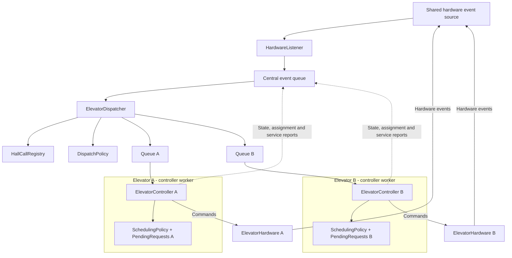

# ארכיטקטורה מוצעת לשתי מעליות

מסמך זה עונה על סעיף ההרחבה לשתי מעליות בתרגיל. זהו תכנון בלבד:
הקוד הקיים ממשיך להפעיל מעלית אחת. הרכיבים וההודעות החדשים המתוארים
כאן אינם ממומשים עדיין.

## הרעיון המרכזי

לכל מעלית יהיה `ElevatorController` עצמאי, שמנהל את הבקשות הפנימיות,
המסלול, התנועה והדלתות שלה. מעל שני הבקרים יהיה `ElevatorDispatcher`
משותף, שיחליט איזו מעלית תטפל בכל קריאה חיצונית.

ה-Dispatcher מחליט **מי ישרת את הקריאה**. הבקר של המעלית שנבחרה מחליט
**איך לבצע את השירות**, תוך שמירה על ההתחייבויות והכללים של המעלית שלו.
ה-Dispatcher אינו שולח פקודות למנוע או לדלתות ואינו מחליף מסלול ישירות.

בקשה פנימית שייכת תמיד למעלית שבה נלחץ הכפתור. קריאה חיצונית מזוהה
לפי קומה וכיוון, ומשויכת לכל היותר למעלית אחת בכל רגע.

## הנחות

- שתי המעליות משרתות את אותן `M` קומות, ולכל אחת פיר נפרד.
- בכל קומה יש זוג כפתורי קריאה משותף לשתי המעליות, למעט כיוונים שאינם
  אפשריים בקומות הקצה. בתוך כל מעלית יש לוח יעדים נפרד.
- החומרה מספקת מקור אירועים משותף לכפתורי הקומות ולשתי המעליות.
  אירוע מתוך מעלית כולל `elevator_id`; קריאה חיצונית עדיין אינה שייכת למעלית.
- בקרי המעליות וה-Dispatcher פועלים באותו תהליך ומשתמשים באותו שעון מונוטוני.
- הנוסע בוחר יעד פנימי אחרי הכניסה למעלית. לכן היעד הסופי של נוסע שממתין
  בקומה אינו ידוע ל-Dispatcher בעת השיוך.

אם החומרה מספקת ערוצי קריאה חוסמים נפרדים, יידרשו חוטי האזנה נוספים
לערוצים האלה. ארבעת חוטי העבודה המתוארים להלן מניחים מקור אירועים משותף.

## רכיבים ואחריות

| רכיב | אחריות |
| --- | --- |
| `ElevatorDispatcher` | רישום קריאות חיצוניות, בחירת מעלית, ניהול שיוכים וניתוב אירועים |
| `HallCallRegistry` | נתוני הקריאות החיצוניות ומצב השיוך; נכתב רק על ידי ה-Dispatcher |
| `DispatchPolicy` | השוואת המעליות והמלצה על שיוך, ללא שינוי מצב או שליחת פקודות |
| `ElevatorController A/B` | בקר נפרד לכל מעלית, שמנהל את המצב והמסלול המקומיים שלה |
| `SchedulingPolicy` | מדיניות הנסיעה הקיימת עבור מעלית בודדת |
| `PendingRequests A/B` | בקשות פנימיות וקריאות חיצוניות שהוקצו למעלית המסוימת |
| `HardwareListener` | קריאת אירועים מהחומרה והעברתם לתור המרכזי |
| `ElevatorHardware A/B` | מתאם פקודות ודיווחי מצב עבור כל מעלית |
| `ElevatorGroupSystem` | יצירה, הפעלה וכיבוי של החוטים והתורים |

המאגר המרכזי הוא המקור הקובע לבעלות על קריאה חיצונית. האוסף המקומי
בכל בקר מחזיק את פרטי הקריאות שהוקצו לו לצורך תכנון המסלול; הבקר מדווח
על השלמתן במקום לשנות ישירות את המאגר המרכזי.

## תרשים הארכיטקטורה

לחיצות בקומות מגיעות ישירות ממקור אירועי החומרה המשותף. התרשים מציג
זרימת הודעות ופקודות; הוא אינו מחייב צורת חיבור פיזית מסוימת לחומרה.

## חוטים, מקביליות ואסינכרוניות

יהיו **ארבעה חוטי עבודה**, נוסף על החוט הראשי שמנהל את חיי המערכת:

1. `HardwareListener` ממתין לאירועי חומרה ומעביר אותם לתור המרכזי.
2. `ElevatorDispatcher` קורא מהתור המרכזי, משייך קריאות חיצוניות ומנתב
   אירועים של מעלית אל התור של הבקר המתאים.
3. `ElevatorController A` מטפל בתור של מעלית A.
4. `ElevatorController B` מטפל בתור של מעלית B.

קליטת אירועים, החלטות השיוך ועבודת שני הבקרים יכולות להתקדם במקביל.
גם שתי המעליות יכולות לנוע או להפעיל דלתות במקביל, בהתאם למצב של כל אחת.
בתוך כל בקר הטיפול באירועים נשאר סדרתי; רק אותו בקר משנה את מצבו המקומי.
רק חוט ה-Dispatcher משנה את מאגר הקריאות והשיוכים המרכזי.

פקודות נסיעה ודלתות נשארות אסינכרוניות כפי שהן במעלית בודדת: אישור
קבלת פקודה חוזר מיד, ואירוע נפרד מדווח על השלמתה. גם הקצאת קריאה לבקר
נעשית באמצעות הודעה ואישור מאוחר יותר; ה-Dispatcher אינו נחסם בהמתנה
לאישור, ולכן יכול להמשיך לנתב דיווחי הגעה ולחיצות.

התורים הם `queue.Queue`. הבקרים מפרסמים צילומי מצב בלתי ניתנים לשינוי,
בלי לשתף אוסף בקשות שניתן לשנות מכמה חוטים. המתאם לחומרה צריך לתמוך
בהאזנה ובפקודות משני הבקרים במקביל, או לתאם את הגישה למשאב חומרה משותף.
ההצעה אינה מחייבת `async/await` ואינה מוסיפה חוט לכל קומה.

## בחירת המעלית לקריאה חיצונית

הבחירה תהיה לפי **זמן משוער עד לפתיחת דלתות לשירות הקריאה בכיוון המבוקש**,
ולא לפי מרחק בקומות בלבד.

לכל מעלית כשירה מעריכים את זמן השירות בעזרת צילום המצב האחרון שלה:
מיקומה וכיוונה, מצב הדלתות, המסלול הפעיל, העצירות שכבר הובטחו והבקשות
הממתינות. אפשר לחשב הערכה באמצעות הרצה יבשה של מדיניות התזמון על עותק
של הנתונים, עם הקריאה החדשה, ללא שליחת פקודות או שינוי מצב הבקר.

ההערכה כוללת זמן נסיעה, פעולות דלתות וזמן המתנה לנוסעים בעצירות קודמות.
מעבר בקומה בכיוון שאינו משרת את הקריאה אינו נחשב הגעה. אם לא ניתן לשלב
את הקריאה במסלול הפעיל, ההערכה כוללת גם את ההמתנה למסלול הבא.
צילום המצב צריך לכלול את הזמן שנותר לפעולה או לשהייה, ככל שהוא ידוע.

מעלית תקולה או מושבתת אינה מועמדת. מבין המועמדות בוחרים את ההערכה
הנמוכה ביותר; בשוויון מעדיפים פחות קריאות חיצוניות משויכות, ואז מזהה
מעלית קבוע כדי שההחלטה תהיה עקבית. קריאות שטרם שויכו נבחנות מהוותיקה
לחדשה, ומביאים בחשבון גם הקצאות שממתינות לאישור.

לדוגמה: לקריאת עלייה בקומה 6, מעלית A בקומה 5 שמחויבת לרדת ל-1
עשויה להתאים פחות ממעלית B בקומה 3 שעולה ומסוגלת לעצור ב-6.

זו הערכה לפי הבקשות הידועות, ולא הבטחה לזמן הגעה או פתרון אופטימלי.
בקשות פנימיות עתידיות, דיווחי מצב מאוחרים וסירוב חומרה לשינוי יעד יכולים
לשנות את זמן השירות בפועל. הערכת הזמן מיועדת לבחירת מעלית; אין צורך
להציג אותה ב-GUI, שבו יכולים להישאר מוני זמן ההמתנה שחלף.

## מחזור החיים של קריאה ושיוך

לכל קריאה חדשה יהיה `request_id`, ולכל ניסיון שיוך יהיה `assignment_id`.
בנוסף נשמרים הקומה, הכיוון, `created_at` המקורי והמעלית שאליה הקריאה שויכה.

1. **קליטה:** ה-Dispatcher רושם את הקריאה. לחיצה נוספת על אותה קומה
   וכיוון כל עוד הקריאה פעילה אינה יוצרת קריאה נוספת ואינה מאפסת את זמנה.
2. **הקצאה:** ה-Dispatcher בוחר מעלית, מסמן הקצאה ממתינה לאישור ושולח
   `AssignHallCall`. מרגע זה הקריאה אינה מוצעת למעלית אחרת.
3. **אישור:** הבקר מאשר שהקריאה נוספה לאוסף שלו, או דוחה אותה אם אינו
   יכול לקבל שירות חדש, למשל בגלל תקלה. אישור השיוך אינו הבטחה לעצירה
   מיידית ואינו אישור חומרה לשינוי יעד בזמן נסיעה.
4. **שירות:** הבקר משלב את הקריאה לפי מדיניות המעלית. אחרי פתיחת הדלתות
   בקומה ובכיוון הנכונים הוא שולח `HallCallServed` עם מזהי הקריאה והשיוך.
5. **השלמה:** ה-Dispatcher מסיים את הקריאה רק אם הדיווח מתאים לשיוך הפעיל.
   לחיצה חדשה לאחר השלמת השירות תקבל מזהה קריאה חדש.

קריאה לעלייה וקריאה לירידה באותה קומה הן שתי קריאות שונות, ויכולות
להיות משויכות למעליות שונות. דיווח שירות ישן אינו רשאי לסיים קריאה חדשה
או שיוך חדש. לכל אירוע של מעלית מוסיפים `elevator_id`; התאמת אישור חומרה
נעשית לפי המעלית וה-`command_id`, כי שני בקרים יכולים לייצר אותו מספר פקודה.

## יציבות השיוך, הוגנות ותקלות

אחרי שהשיוך התקבל משאירים את הקריאה אצל אותה מעלית. לא מעבירים אותה
בכל שינוי קטן בהערכת זמן ההגעה. הכלל מצמצם שינויי מסלול ומונע מצב שבו
קריאה עוברת שוב ושוב בין המעליות בלי לקבל שירות.

הבקר המקומי ממשיך לתת עדיפות לבקשות פנימיות לפי המדיניות הקיימת,
לשמור על התחייבויות ולהעלות את עדיפותן של קריאות חיצוניות ותיקות.
זמן ההמתנה נמדד מהלחיצה המקורית, כולל הזמן לפני השיוך ובמהלך שיוך מחדש.
סף ההמתנה הקיים הוא פרמטר, לא הבטחה לזמן איסוף מרבי. שתי מעליות אינן
מבטלות את הצורך במדיניות הוגנות בכל בקר.

אם בקר דוחה הקצאה, אפשר לבחור מעלית אחרת. אם מעלית מתקלקלת אחרי שאישרה
הקצאה, משייכים מחדש רק קריאות חיצוניות שטרם שורתו, לאחר אישור שחרור
מהבקר הישן: הוא מדווח אילו קריאות הושלמו ואילו הוא לא ימשיך לשרת.
רק אז מבטלים את הבעלות הישנה ויוצרים שיוך חדש עם אותו זמן קריאה מקורי.

אי-קבלת אישור בזמן אינה הוכחה שהמעלית הישנה שחררה את הקריאה. במקרה כזה
מסמנים את השיוך כלא ודאי ומדווחים על תקלה; לא שולחים אוטומטית מעלית נוספת
לאותה קריאה לפני בירור. מזהי השיוך מונעים מדיווחים מאוחרים לשנות שיוך חדש,
אבל לבדם אינם מונעים מהמעלית הישנה להגיע פיזית לקומה.

בקשות פנימיות של מעלית תקולה אינן מועברות לבקר השני, כי הנוסעים נמצאים
במעלית המקורית. טיפול פיזי בתקלה ובהגנות החומרה נשאר באחריות מערכת החומרה.
כאשר אין מעלית כשירה, הקריאה נשמרת ומצב חוסר הזמינות מוצג למשתמש.

## השינויים הנדרשים לעומת הפרויקט הקיים

| חלק קיים | השינוי בהרחבה |
| --- | --- |
| `ElevatorController` | שני מופעים נפרדים; קבלת הודעות שיוך ושחרור ופרסום דיווחי מצב ושירות |
| `SchedulingPolicy` ו-`PendingRequests` | שימוש בכל מעלית בנפרד; שמירת הקשר בין קריאה מקומית למזהי השיוך |
| אירועי חומרה | הוספת זהות המעלית לאירועים המתאימים וניתוב דרך התור המרכזי |
| `HardwareListener` | האזנה למקור האירועים המשותף |
| `ElevatorSystem` | החלפה במנהל קבוצת מעליות שיוצר Listener אחד, Dispatcher ושני Controllers |
| ממשק החומרה | מתאם לכל מעלית, מקור אירועים משותף ועדכון תצוגות לפי זהות המעלית |
| תצוגה | הצגת הקומה והכיוון של A ושל B בכל קומה; לוח יעדים נפרד בכל תא |

לכן לא מפעילים פשוט שני מופעים מלאים של `ElevatorSystem` הנוכחי:
כל מופע כזה יוצר גם חוט האזנה משלו, ואין בו רכיב שמנהל בעלות משותפת
על קריאות הקומות. משתמשים מחדש בבקרים ובמדיניות, ומשנים את שכבת הניהול.

## תרחישים שכדאי לבדוק אם מממשים

- קריאה חיצונית משויכת למעלית אחת בלבד, גם תחת לחיצות חוזרות.
- שתי קריאות בכיוונים שונים באותה קומה נשארות עצמאיות.
- בקשה פנימית משנה רק את המעלית שבה נלחץ הכפתור.
- מעלית רחוקה שנוסעת בכיוון המתאים יכולה להיבחר לפני מעלית קרובה ועסוקה.
- שתי המעליות ממשיכות לטפל באירועים בזמן שאחת נוסעת או מפעילה דלתות.
- תקלה, שחרור ושיוך מחדש שומרים על זמן הקריאה ועל בעלות יחידה.
- אירוע שירות מאוחר או מספר פקודה זהה במעלית אחרת אינם משלימים בקשה שגויה.
- כיבוי תוכנה מעיר את חוט ההאזנה ואת כל התורים ומסיים את ארבעת חוטי העבודה.

הכיבוי המתוכנן נעשה אחרי סיום השירות. כמו במימוש הקיים, סיום חוטי התוכנה
אינו פקודת עצירת מנוע ואינו תחליף למנגנוני החומרה.
