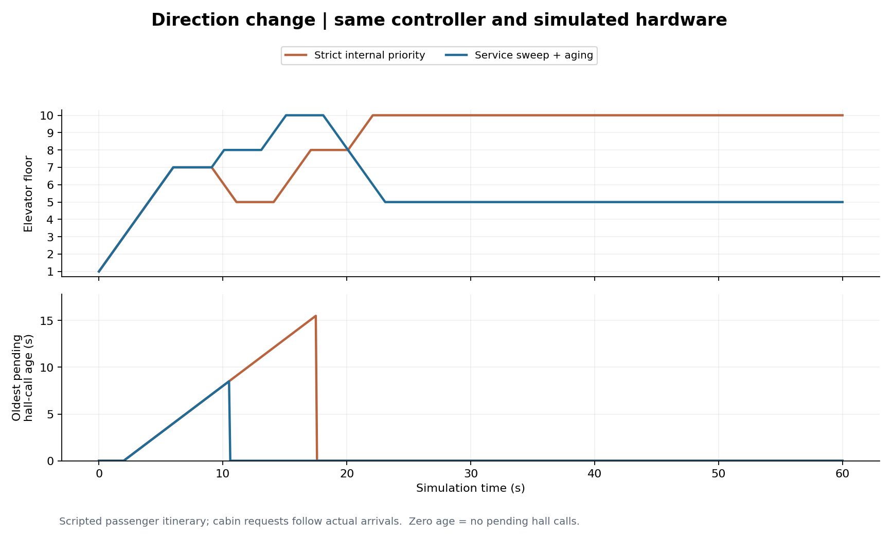
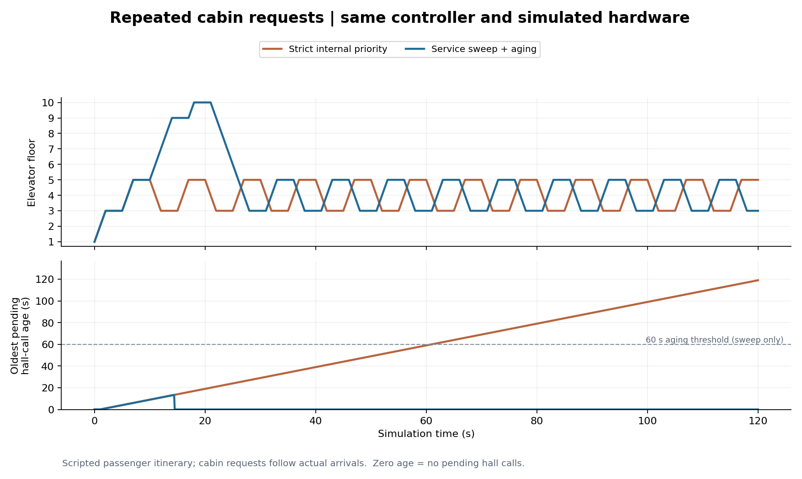
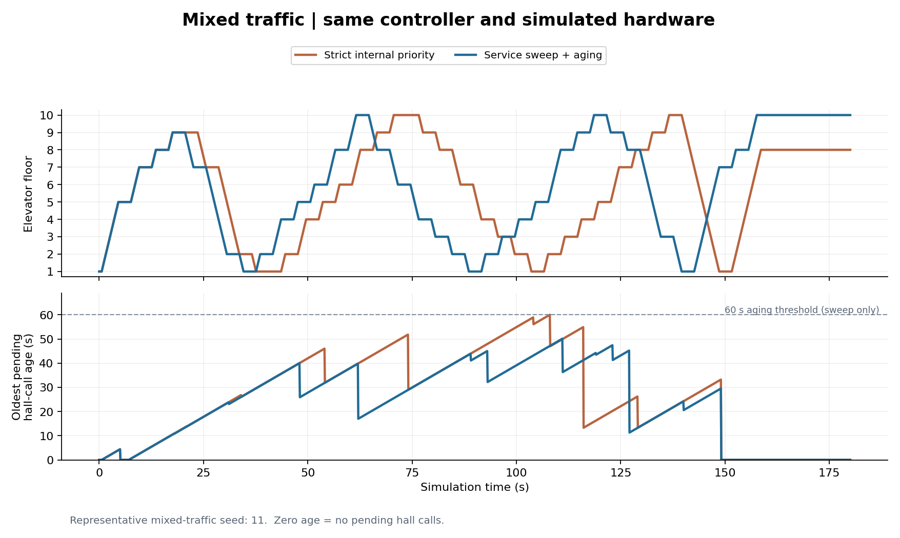
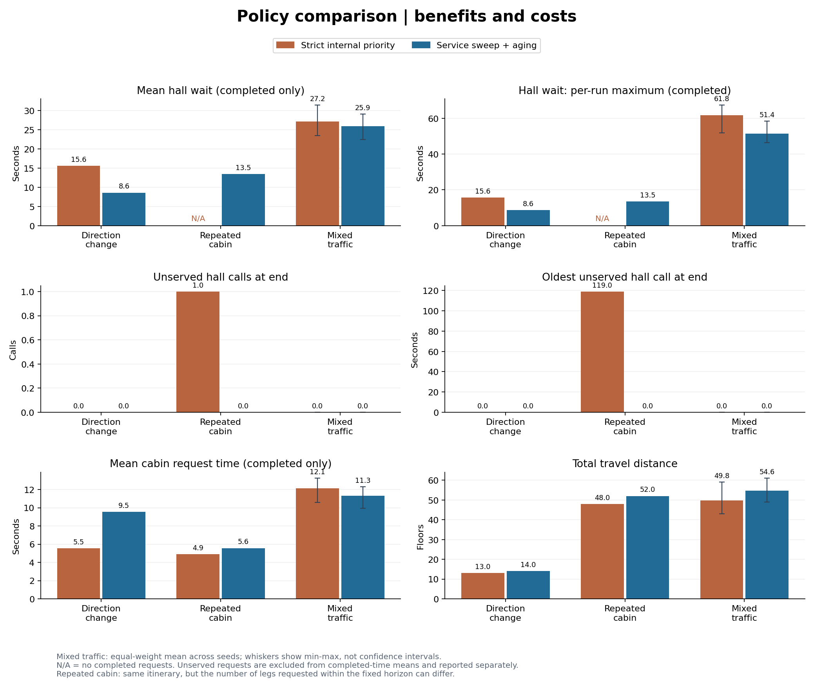

# השוואת מדיניות התזמון של המעלית

הדוח משווה שתי מדיניות על אותו בקר ואותה חומרה מדומה, בבניין של 10 קומות. המטרה היא לבדוק איך בחירת המסלול משפיעה על ההמתנה בחוץ, על הבקשות בתוך התא ועל מרחק הנסיעה.

- **כתום — Baseline:** בקשות פנימיות מקבלות עדיפות בכל החלטה חדשה לאחר עצירה. אפשר לאסוף קריאה חיצונית מתאימה בדרך, אבל אין מנגנון שמקדם קריאה בגלל גילה.
- **כחול — המדיניות שלנו:** המעלית ממשיכה לשרת בקשות בהמשך כיוון הנסיעה לפני חזרה לאחור. יש גם מנגנון לקידום קריאות חיצוניות ותיקות, עם סף של 60 שניות.

כל הזמנים בדוח הם **שניות סימולציה**. הרצה מלאה: `py -m comparison`. עדכון הגרפים והדוח מהנתונים השמורים: `py -m comparison --plot-only`. [הסבר שיטת המדידה והוראות הרצה](../README.md).

## איך לקרוא את גרפי התרחישים

בכל תרחיש מוצגים שני גרפים עם אותו ציר זמן:

- **הגרף העליון — מיקום המעלית:** הציר האופקי הוא הזמן והאנכי הוא הקומה. קו עולה או יורד מראה נסיעה; קו אופקי מראה שהמעלית נשארת באותה קומה, למשל בזמן שירות או כשהיא פנויה.
- **הגרף התחתון — גיל הקריאה החיצונית הוותיקה שעדיין ממתינה:** גובה הקו הוא הזמן מאז הלחיצה הראשונה על אותה קריאה. ירידה יכולה לציין שהקריאה הוותיקה טופלה ועכשיו קריאה צעירה יותר היא הוותיקה ביותר. אפס פירושו שאין קריאות חיצוניות ממתינות. זה אינו זמן הגעה משוער.

קו מקווקו בגובה 60 שניות, כשהוא מוצג, מציין את סף קידום הקריאות במדיניות שלנו. **הוא אינו הבטחה לאיסוף בתוך 60 שניות**: עדיין צריך להשלים פעולות נוכחיות ולנסוע אל הנוסע.

## תרחיש 1 — בקשה לרדת בזמן שיש קריאה בהמשך העלייה

המעלית מתחילה בקומה 1 עם נוסע שבוחר 7. בזמן 2 מופיעה בקומה 8 קריאה לעלות, של נוסע שרוצה להגיע ל־10. כשהדלתות נפתחות ב־7, הנוסע שבתא בוחר 5. הניסוי בודק אם המעלית תחזור מיד ל־5 או תשלים קודם את השירות למעלה.

**מה רואים:** ב־baseline סדר העצירות הוא 7, אחר כך 5, אחר כך 8 ולבסוף 10. במדיניות שלנו הסדר הוא 7, אחר כך 8, אחר כך 10 ולבסוף 5. בגרף התחתון אפשר לראות מתי ההמתנה של הקריאה בקומה 8 מסתיימת בכל מדיניות.

**תוצאות ההרצה:** זמן ההמתנה בקומה 8 הוא 15.60 לעומת 8.60 שניות (baseline לעומת שלנו). זמן הטיפול הממוצע בבקשות פנימיות שהושלמו הוא 5.53 לעומת 9.53 שניות.

**מה הגרף נותן:** המחשה ישירה של המחיר והיתרון בשמירה על כיוון הנסיעה. הנוסע בקומה 8 נאסף מוקדם יותר, אבל הבקשה לרדת ל־5 נדחית. שיפור השירות בחוץ עשוי להאריך בקשה מתוך התא.

## תרחיש 2 — נוסע שמבקש שוב ושוב 3 ו־5

המעלית מתחילה בקומה 1 עם נוסע שמבקש לסירוגין 3 ו־5. כל בקשה נוספת נלחצת רק כשהדלתות נפתחות ביעד הקודם. בזמן 1 נוסע בקומה 9 מזמין מעלית למעלה, כדי להגיע ל־10. חלון המדידה הוא 120 שניות.

**מה רואים:** הקו הכתום נע הלוך ושוב בין 3 ל־5, וגיל הקריאה בקומה 9 ממשיך לעלות. הקו הכחול ממשיך מ־5 לאיסוף ב־9, משרת את 10 ורק אז חוזר לבקשה הנמוכה.

**תוצאות ההרצה:** ב־baseline הקריאה בקומה 9 עדיין ממתינה אחרי 119.00 שניות בסוף הניסוי. במדיניות שלנו היא מטופלת אחרי 13.50 שניות.

**מה הגרף נותן:** הדגמה של דחייה ממושכת שעלולה להיווצר מעדיפות פנימית קשיחה. בהרצה הזאת המדיניות שלנו מגיעה ל־9 עוד לפני סף 60 השניות, בזכות המשך העלייה. לכן זהו בעיקר ניסוי של שמירה על כיוון, ולא הוכחה נפרדת ליעילות מנגנון קידום הקריאות הוותיקות.

הניסוי מסתיים בזמן קבוע: הקריאה שלא טופלה אינה מקבלת זמן המתנה אפס. בנוסף, מכיוון שבקשות פנימיות נוצרות אחרי הגעה בפועל, מספר הבקשות שנוצרו והושלמו בתוך 120 שניות עשוי להיות שונה בין המדיניות, למרות מסלול הנוסע הזהה.

## תרחיש 3 — תנועה מעורבת של נוסעים

בכל הרצה נוצרים 30 נוסעים, עם קומות מוצא ויעד שונות וזמני הגעה בין 0 ל־120 שניות. המדידה נמשכת 180 שניות. כל נוסע לוחץ על יעד פנימי רק לאחר שנאסף. לשתי המדיניות ניתנים אותם נוסעים ואותם זמני הגעה בכל זוג הרצות.

הדוח כולל 5 ערכי seed: 11, 22, 33, 44, 55. ה־seed מאפשר לשחזר את הגרלת הנוסעים. הגרף הבא מציג רק את הריצה עם seed=11; הוא אינו ממוצע של כל הריצות.

**מה רואים:** בגרף העליון אפשר להשוות את סבבי העלייה והירידה ואת העצירות. בגרף התחתון הקריאה הוותיקה משתנה במהלך הניסוי, ולכן יש כמה ירידות ועליות. אי אפשר לחשב את ההמתנה הממוצעת לכל הקריאות רק מצורת הקו הזה; לשם כך משתמשים בנתוני הבקשות.

**תוצאות ההרצה המוצגת:** ההמתנה הממוצעת לקריאה חיצונית שהושלמה היא 25.00 לעומת 26.65 שניות (baseline לעומת שלנו). בממוצע על כל ה־seeds הערכים הם 27.18 לעומת 25.91 שניות. מרחק הנסיעה הממוצע הוא 49.80 לעומת 54.60 קומות.

**מה הגרף נותן:** בדיקה של ההתנהגות כשכמה נוסעים ובקשות מתחרים על השירות. צריך לבחון גם את ההמתנה וגם את מרחק הנסיעה, ולהבחין בין תוצאה של הרצה אחת לבין הממוצע הכולל. אין כאן הוכחה שמדיניות אחת עדיפה בכל עומס אפשרי.

## גרף הסיכום — היתרונות והמחירים בכל התרחישים

כל זוג עמודות משווה baseline בכתום למדיניות שלנו בכחול. ששת המדדים הם:

| מיקום בגרף | המדד | מה הוא עוזר לבדוק |
| --- | --- | --- |
| למעלה משמאל | זמן המתנה חיצוני ממוצע, לקריאות שהושלמו | כמה זמן מחכים בחוץ בממוצע |
| למעלה מימין | זמן ההמתנה החיצוני המרבי בכל הרצה, לקריאות שהושלמו | מה הייתה ההמתנה הארוכה ביותר; בתנועה מעורבת העמודה היא ממוצע של המקסימום מכל הרצה |
| באמצע משמאל | מספר הקריאות החיצוניות שנותרו ממתינות | האם ממוצע טוב מסתיר קריאות שלא קיבלו שירות |
| באמצע מימין | גיל הקריאה הוותיקה שנותרה בסוף | כמה זמן כבר מחכה הקריאה שלא טופלה; אפס אם לא נותרו קריאות |
| למטה משמאל | זמן ממוצע מלחיצה פנימית ועד פתיחת הדלתות ביעד, לבקשות שהושלמו | מה המחיר לנוסעים שבתא |
| למטה מימין | מרחק הנסיעה הכולל, ביחידות של קומות | כמה המעלית נסעה כדי לספק את השירות; זה אינו מדד ישיר לצריכת חשמל |

בתרחישי 7–8–5 ו־3–5 יש הרצה אחת לכל מדיניות. בתנועה המעורבת כל עמודה היא ממוצע במשקל שווה של המדד מכל seed. הפסים הדקים מציינים את המינימום והמקסימום בין הריצות, ולא רווח סמך.

**איך מסיקים מסקנה:** יש לקרוא יחד את זמני ההמתנה, הקריאות שלא טופלו ומרחק הנסיעה. למשל, בתרחיש החוזר ה־baseline מציג `N/A` להמתנה חיצונית שהושלמה, כי אף קריאה חיצונית לא הושלמה — לא מפני שלא הייתה המתנה. הגרף מסייע לבחור מדיניות לפי סדר העדיפויות הרצוי, ולא רק לפי עמודה אחת.

## נתוני הסיכום

### שינוי כיוון: 7, 8 ו־5

| מדד | Baseline | המדיניות שלנו |
| --- | ---: | ---: |
| קריאות חיצוניות שהושלמו | 1.00 | 1.00 |
| קריאות חיצוניות ממתינות בסוף | 0.00 | 0.00 |
| המתנה חיצונית ממוצעת, שהושלמה (שניות) | 15.60 | 8.60 |
| גיל הקריאה הוותיקה בסוף (שניות) | 0.00 | 0.00 |
| זמן בקשה פנימית ממוצע, שהושלמה (שניות) | 5.53 | 9.53 |
| מרחק נסיעה (קומות) | 13.00 | 14.00 |

### בקשות פנימיות חוזרות: 3 ו־5

| מדד | Baseline | המדיניות שלנו |
| --- | ---: | ---: |
| קריאות חיצוניות שהושלמו | 0.00 | 1.00 |
| קריאות חיצוניות ממתינות בסוף | 1.00 | 0.00 |
| המתנה חיצונית ממוצעת, שהושלמה (שניות) | לא זמין | 13.50 |
| גיל הקריאה הוותיקה בסוף (שניות) | 119.00 | 0.00 |
| זמן בקשה פנימית ממוצע, שהושלמה (שניות) | 4.90 | 5.57 |
| מרחק נסיעה (קומות) | 48.00 | 52.00 |

### תנועה מעורבת

| מדד | Baseline | המדיניות שלנו |
| --- | ---: | ---: |
| קריאות חיצוניות שהושלמו | 20.80 | 21.40 |
| קריאות חיצוניות ממתינות בסוף | 0.00 | 0.00 |
| המתנה חיצונית ממוצעת, שהושלמה (שניות) | 27.18 | 25.91 |
| גיל הקריאה הוותיקה בסוף (שניות) | 0.00 | 0.00 |
| זמן בקשה פנימית ממוצע, שהושלמה (שניות) | 12.11 | 11.32 |
| מרחק נסיעה (קומות) | 49.80 | 54.60 |

## גבולות ההשוואה

- בקשות שלא הושלמו אינן נכללות בממוצעי זמן הטיפול. גילן נמדד עד סוף הניסוי בלבד; זמן השירות הסופי שלהן אינו ידוע.
- לחיצות חיצוניות על אותה קומה ואותו כיוון מתאחדות לקריאה אחת; בקשות פנימיות מתאחדות לפי יעד. לכן המדדים בגרפים הם לפי בקשה, ולא בהכרח לפי נוסע. אותם נוסעים יכולים ליצור מספר שונה של קריאות בשתי המדיניות. נתוני המתנה לפי נוסע נשמרים בנפרד בקובצי הנתונים.
- התנועה המעורבת מסוכמת כממוצע בין הרצות, ולכן אפילו מספר הקריאות הממוצע יכול להיות שבר.
- ההשוואה מחליפה יחד את מדיניות המשך הכיוון ואת מנגנון קידום הקריאות הוותיקות. כדי לבודד את התרומה של כל מנגנון נדרש ניסוי נוסף.
- אלו ניסויים מוגדרים בסימולציה. התוצאות תלויות בנוסעים, בזמני הנסיעה והדלתות ובמשך המדידה, ואינן מוכיחות יתרון גורף או עמידה בדרישה של עדיפות פנימית מוחלטת.

הנתונים המלאים זמינים ב־[summary.csv](data/summary.csv), ותיאור הנוסעים והגדרות הניסוי ב־[manifest.json](data/manifest.json).
