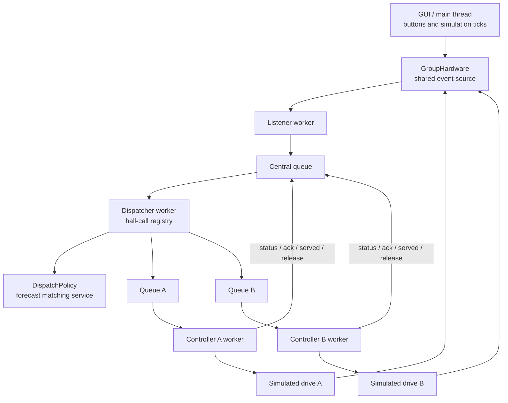

# שתי מעליות — הרחבה נפרדת עם ממשק גרפי

כל קוד ההרחבה נמצא בתיקייה `elevator_group`. משתמשים מחדש ב־`ElevatorController`,
במדיניות התזמון ובחומרה המדומה הקיימים. הבקר והסימולטור של מעלית אחת ממשיכים
לפעול בנפרד. הממשק באנגלית, כמו הסימולטור המקורי.

## הפעלה

מתיקיית הפרויקט הראשית, עם Python 3.10 ומעלה ו־Tkinter:

```powershell
py -m elevator_group
```

להפעלת שתי המעליות עם מדיניות ה־baseline:

```powershell
py -m elevator_group --policy baseline
```

אין חבילות נוספות להתקנה. יש 10 קומות, מעלית A מתחילה בקומה 1 ומעלית B
בקומה 10. לכל אחת פיר נפרד. אין נסיעה אוטומטית לקומות חניה כשאין בקשות.

## שימוש בממשק

- כפתורי ▲ ו־▼ בקומות משותפים לשתי המעליות. לחיצה יוצרת קריאה אחת לקומה ולכיוון.
- `WAIT TIME / ASSIGNED` מציג את זמן ההמתנה שחלף ואת אות המעלית שנבחרה, למשל
  `A 00:04`. עלייה וירידה נמדדות בנפרד. זה אינו זמן הגעה משוער.
- קריאה ללא מעלית כשירה נשמרת ומוצגת עם `?`. סימן `!` מציין שאישור שיוך או
  שחרור מאחר: הבעלות נשמרת כדי למנוע שליחת שתי מעליות לאותה קריאה.
- שני הפירים מציגים מיקום רציף, אנימציית דלתות וסימון היעד הבא.
- לוחות התא נפרדים: בחירה בלוח A משנה רק את בקשות A. יש לבחור את לוח
  המעלית שאליה נכנסים; המערכת אינה יודעת לאיזו מעלית הנוסע נכנס בפועל.
- בכרטיס של כל מעלית מוצגים הקומה המדווחת, הכיוון, מצב הדלתות והמסלול.
- `Demo traffic` שולח בקשות פנימיות A→7 ו־B→4, וקריאות חיצוניות 3↑ ו־8↓.
  הוא זמין כשהקבוצה פנויה וממחיש נסיעה של שתי המעליות במקביל.
- `Disable lift A/B` מקפיא את המעלית המדומה וגורם לתקלה בבקר שלה. קריאות
  חיצוניות שטרם שורתו מועברות למעלית השנייה רק לאחר אישור שחרור. הבקשות
  הפנימיות נשארות אצל המעלית התקולה. זו הדמיית תקלה, ללא מנגנון חילוץ או
  פקודת חירום למעלית אמיתית.
- `Reset simulation` מסיים את ארבעת החוטים, יוצר מערכת חדשה ומשחזר את
  קומות ההתחלה. המדיניות שנבחרה נשמרת. סגירת החלון מסיימת את כל החוטים.

## הארכיטקטורה



יש **ארבעה חוטי עבודה**, נוסף לחוט הראשי של Tkinter: מאזין משותף,
Dispatcher ושני בקרים. לכל מעלית מופע עצמאי של המדיניות. רק ה־Dispatcher
כותב את מאגר הקריאות המרכזי, ורק חוט הבקר המתאים משנה את הבקשות המקומיות שלו.
ה־GUI קורא snapshots בלתי ניתנים לשינוי ואינו משנה את מצב הבקרים.

החומרה הקיימת מדמה תנועה כשה־GUI קורא ל־`tick`. המתאם החדש אוסף את
האירועים משתי המעליות, מוסיף `elevator_id` ומעביר אותם למקור המשותף.
אירועים שנוצרו במהלך פקודת חומרה יכולים להמתין עד ל־tick הבא, בדרך כלל
כ־25 אלפיות שנייה. אין חוט האזנה נוסף לכל מעלית.

## בחירת מעלית

`DispatchPolicy` מעריכה את הזמן עד לפתיחת דלתות בקומה **ובכיוון המבוקש**:

1. מעתיקים את הבקשות והמסלול מצילום המצב האחרון.
2. מוסיפים קריאות שכבר שויכו, כולל שיוכים שטרם אושרו, ובקשות פנימיות שטרם
   אושרו בדיווח הבקר. כך רצף לחיצות אינו מתעלם מעומס שכבר נשלח לתורים.
3. מריצים תחזית של מדיניות התזמון, הכוללת נסיעה, עצירות, פתיחת וסגירת דלתות
   ושהייה עם דלתות פתוחות. בדלתות פתוחות בכיוון המתאים אפשר לשרת קריאה מיד.
4. בוחרים את הזמן המשוער הקצר ביותר. בשוויון מעדיפים פחות שיוכים חיצוניים,
   ואז מזהה קבוע A לפני B. מעלית תקולה אינה מועמדת.

למשל, A בקומה 5 שמחויבת לרדת ל־1 יכולה להתאים פחות לקריאת 6↑ מאשר B
בקומה 3 שנוסעת למעלה. ההחלטה אינה מבוססת רק על הפרש הקומות.

זו הערכה לפי המצב המדווח והבקשות הידועות, ולא הבטחת זמן או אופטימום.
צילום מצב יכול להתיישן, בקשות חדשות יכולות להגיע וחומרה יכולה לסרב לשינוי
יעד. התחזית משתמשת במודל העצירה הפשוט של הסימולטור ובמספר איטרציות מוגבל.
היא אינה מניעה חומרה ואינה משנה את הבקר האמיתי. מדיניות מותאמת נוספת צריכה
לשמור על פעולות תכנון ללא תופעות לוואי, כמו המדיניות הקיימות.

## בעלות, אישורים ותקלות

לכל קריאה יש `request_id`, ולכל ניסיון שיוך יש `assignment_id`. הקריאה נשמרת
לפי קומה וכיוון, ולחיצות חוזרות שומרות על הזמן המקורי. הבעלות נשמרת כבר
לפני הכנסת הודעת השיוך לתור, ומעלית נוספת אינה מקבלת אותה קריאה.

הבקר מאשר את השיוך ומדווח על השלמה רק אחרי פתיחת דלתות לשירות המתאים.
ה־Dispatcher בודק גם את זהות המעלית וגם את שני המזהים. דיווח ישן אינו יכול
לסיים שיוך חדש או קריאה חדשה. מזהי פקודות חומרה נשארים מקומיים לכל מעלית,
ולכן מספר פקודה זהה ב־A וב־B אינו יוצר התנגשות.

שיוך שהתקבל נשאר יציב. שינוי קטן בתחזית אינו מעביר אותו בין המעליות.
במקרה של תקלה, הבקר התקול משחרר את הקריאות החיצוניות ומפסיק לתכנן פעולות;
רק אישור השחרור מאפשר שיוך חדש, עם אותו זמן יצירה ומזהה שיוך חדש.
בקשות פנימיות אינן מועברות. כשאין מעלית כשירה הקריאות נשמרות ללא שיוך.
אם אישור שיוך או שחרור אינו מגיע בזמן, הקריאה מסומנת `uncertain` ונשארת
בבעלות הקודמת. אין העברה אוטומטית המבוססת רק על חלוף הזמן.

הבקרים המקומיים ממשיכים להשתמש בסף קידום קריאות של 60 שניות במדיניות שלנו.
זה אינו חסם מובטח לזמן המתנה כולל. `stop` מסיים תוכנה ומקפיא את הסימולציה;
הרחבה זו אינה בקר בטיחות למעלית פיזית.

## קבצים ובדיקות

| קובץ | אחריות |
| --- | --- |
| `messages.py` | הודעות, מזהים וצילומי מצב בלתי ניתנים לשינוי |
| `hardware.py` | שני כוננים מדומים ומקור אירועים משותף |
| `controller.py` | עטיפת הבקר הקיים להודעות שיוך, שחרור ודיווח |
| `dispatch_policy.py` | תחזית זמן שירות ובחירת מעלית |
| `dispatcher.py` | מאגר הקריאות, בעלות וניתוב הודעות |
| `system.py` | יצירה, הפעלה וכיבוי של ארבעת החוטים |
| `app.py` | ממשק Tkinter ואנימציה |
| `tests/test_group.py` | תרחישים עם זמן מדומה ובדיקות חוטים אמיתיים |

```powershell
py -m unittest elevator_group.tests.test_group -v
py -m unittest discover -v
```

הבדיקות כוללות שיוך יחיד, כפילויות, כיוונים נפרדים, העדפת כיוון על פני
קרבה, בקשות פנימיות נפרדות, הזמנות הממתינות לאישור, השלמה רק בפתיחת דלתות,
שחרור לפני שיוך מחדש, שמירת זמן ההמתנה, דיווחים ישנים, חוסר זמינות וכיבוי
ארבעת החוטים. הבדיקות הדטרמיניסטיות משתמשות באותם מטפלי הודעות ואותה
חומרה עם שעון ידני; בדיקות החוטים מריצות גם את המערכת בפועל.
